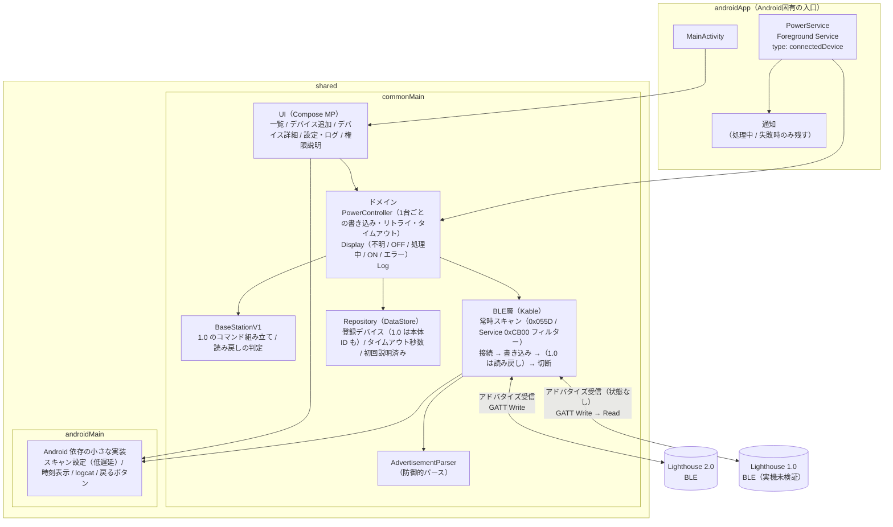

最終更新: 0.3.0

# 01. 全体構成

- 画面・ドメイン・BLE・永続化はすべて `shared/commonMain` に置く。iOS を足すときは `iosMain` と iOS アプリを追加するだけで済む形にする
- `androidApp` は Activity・Foreground Service・通知と、DataStore のファイルパスの受け渡しだけを持つ。書き込み処理の本体はドメイン層にあり、Service はそれを「アプリを閉じても動かし続ける」ための入れ物
- 2.0 の状態は BLE 層のスキャン結果（アドバタイズ）だけから得る。GATT Read は使わない
- 1.0 はアドバタイズに状態が出ないため、書き込み直後に同じ接続で読み戻して受け付けを確認する（例外。表示は「送信済み」）
- スキャンは「画面表示中」または「処理中」のどちらかが真の間ずっと開始したまま。画面と Service で同じスキャンを共有し、頻繁に start/stop しない
