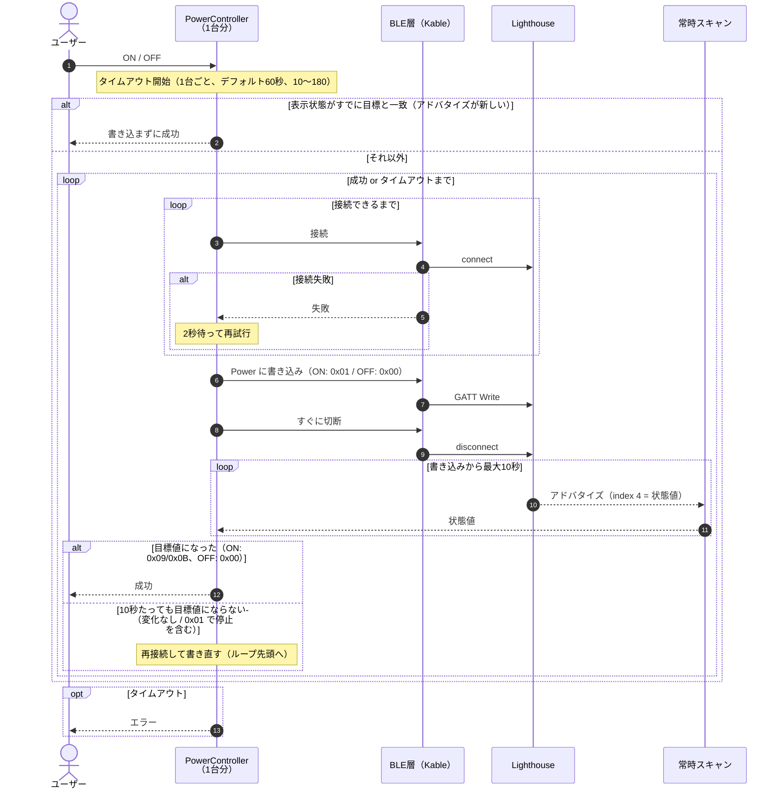

最終更新: 0.1.0

# 02. ON/OFF 書き込みフロー

1台分のフロー。「全部ON/OFF」では、これが台数分**独立して並列**に走る（内部デバッグフラグが有効なときは「接続の確立」だけ直列）。

- 書き込みのあとはすぐ切断し、成否は**アドバタイズの状態値だけ**で判定する
- 接続失敗は2秒の固定間隔で再試行する。書き込みから10秒以内に目標値にならなければ、再接続から書き直す。どちらもタイムアウトの範囲内で行う
- 「すでに目標と一致」は、アドバタイズが新しい（不明になっていない）ときだけ。古い・不明なら念のため書き込む
- 処理中に逆の操作をされたら、その台の処理をキャンセルして新しい目標でやり直す（タイムアウトも取り直す）
- 接続・書き込み・リトライ・状態の変化はすべてログに記録する
