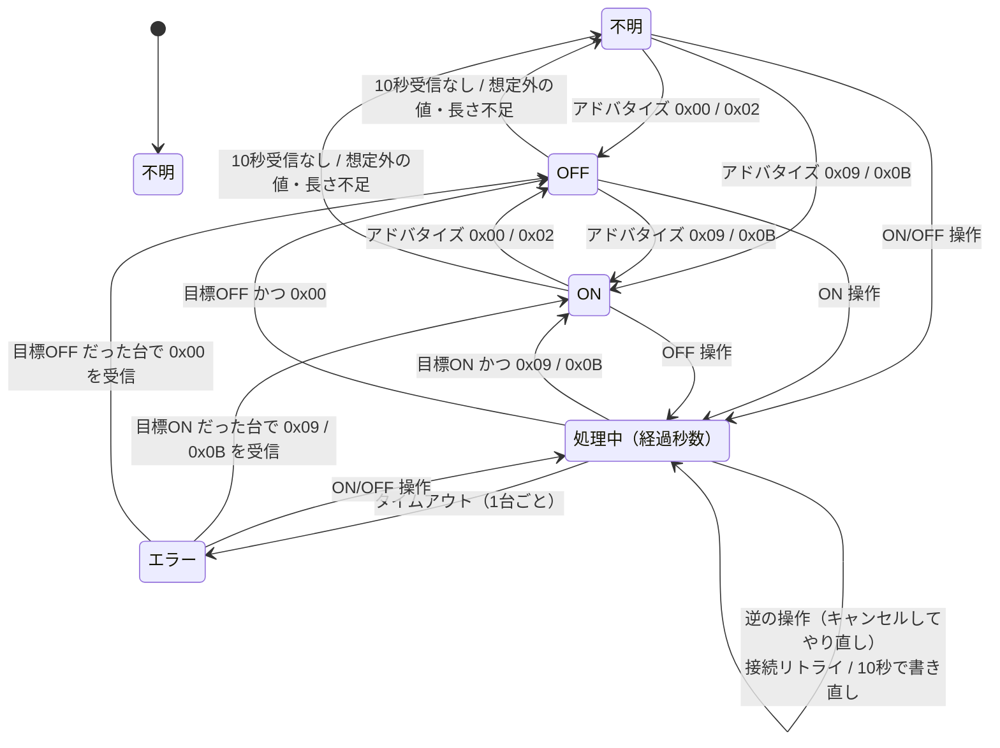

最終更新: 0.2.0

# 03. 1台ごとの表示状態

- 処理していない台の表示はアドバタイズの値そのまま。`0x01`（起動中）を処理外で受信したときは「処理中」ではなく直前の表示のままにする
- 10秒アドバタイズを受信しなければ「不明」に戻す。最終確認時刻（最後に受信した時刻）はカードに常に表示する
- 処理中は、目標値を受信するまで「処理中（経過秒数）」を表示し続ける。途中で `0x01` を受信しても処理中のまま
- 「エラー」は次の操作をするか、もともとの目標値をアドバタイズで受信するまで保持する
- すでに目標と一致している台への操作は、処理中を経由せずそのまま（02 を参照）
