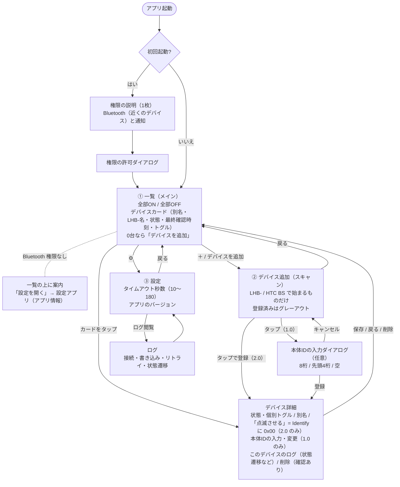

最終更新: 0.3.0

# 04. 画面遷移

- 初回だけ権限の説明画面を挟む。通知を拒否されても先に進め、処理も動く
- 説明画面は許可・拒否どちらでも一度通れば二度と出さない
- Bluetooth の権限が拒否されている間は、一覧の上に案内と「設定を開く」（設定アプリのアプリ情報）を出す。設定アプリから戻ると反映される
- 登録はタップした時点で行い、詳細画面で別名を保存せずに戻っても登録は残る
- 詳細画面は登録直後と一覧のカードタップで同じものを開く（登録後も点滅で実機を確かめながら別名を変えられる）
- 1.0 は登録前に本体IDを聞くが、空のままでもよい（スリープを確実にしたい人だけ入れる）。あとから詳細画面で入力・変更できる。1.0 には Identify がないので点滅ボタンは出さない
